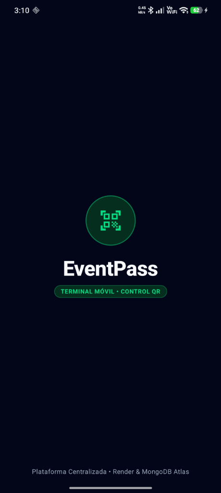
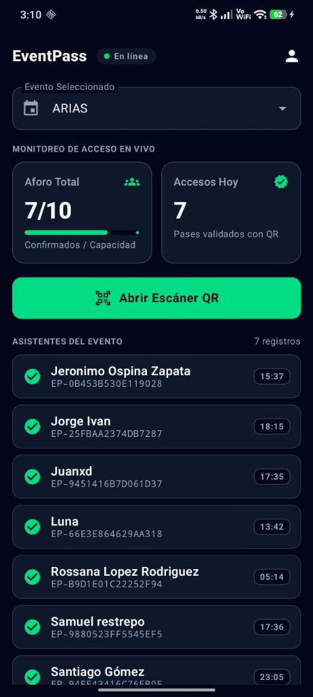
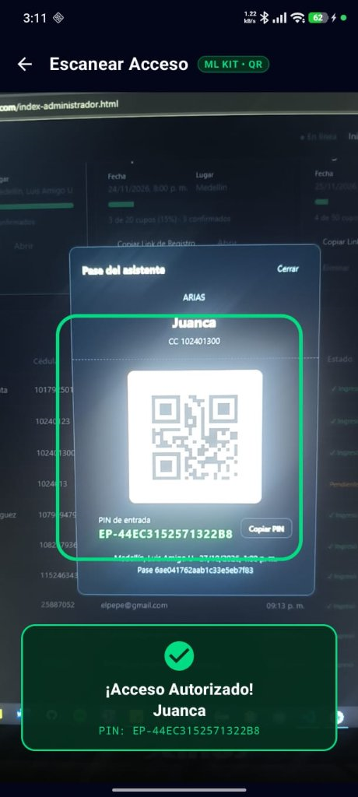

# EventPass App (MVP) — Terminal Móvil de Control de Asistencia con QR

Aplicación móvil desarrollada para Android con **Kotlin** y **Jetpack Compose** que actúa como **terminal de acceso (MVP)** conectada a la plataforma web centralizada de **EventPass** desplegada en Render ([Consola de Integración Web](https://eventpass-web-cnyn.onrender.com/pages/interaccion.html)).

El proyecto permite autenticar al personal/administrador mediante **JWT**, monitorear el aforo del evento y validar boletos mediante el escaneo de códigos QR en tiempo real utilizando el patrón **MVVM**, almacenamiento seguro con **EncryptedSharedPreferences** y una arquitectura preparada para operación **Offline-First**.

---

## 🎨 Diseños de Interfaz

El diseño UI/UX se conceptualizó previamente en Figma y se implementó de manera declarativa con Jetpack Compose (Material Design 3):

| 1. Splash Screen | 2. Home Screen | 3. Escáner QR |
| :---: | :---: | :---: |
|  |  |  |

---

## 📱 Vistas Implementadas y Mejoras del MVP

1. **Splash Screen (`SplashScreen.kt`):** Pantalla de inicio con identidad visual, temporizador de 2 segundos y transición automática hacia el flujo de autenticación limpiando el backstack.
2. **Autenticación y Login (`LoginScreen.kt` & `LoginViewModel.kt`):**
   * Formulario reactivo con soporte para usuario/correo y visibilidad de contraseña.
   * Manejo de estados con `StateFlow` (`Idle`, `Loading`, `Success`, `Error`).
   * Conexión al endpoint `POST /api/auth/login` mediante **Retrofit** para obtener el token JWT del servidor Node.js/Express.
3. **Home Screen / Dashboard (`DashboardScreen.kt` & `DashboardViewModel.kt`):**
   * Panel central con tarjetas de monitoreo de **Aforo Total** y **Accesos Hoy**.
   * Lista en tiempo real de los últimos asistentes registrados con folio y hora de ingreso.
   * Accesos directos al lector QR desde barra superior, botón principal y `FloatingActionButton`.
4. **Escáner QR Inteligente (`ScannerScreen.kt`, `QrCodeAnalyzer.kt` & `ScannerViewModel.kt`):**
   * Solicitud dinámica de permisos de cámara en tiempo de ejecución con vista de respaldo si el permiso es denegado.
   * Integración de **CameraX** (`Preview` + `ImageAnalysis`) con **Google ML Kit Barcode Scanning** filtrado exclusivamente para `FORMAT_QR_CODE`.
   * **Control de memoria y Debounce (2 segundos):** Uso de `AtomicBoolean`, control de *throttling* por timestamp y cierre garantizado de frames (`imageProxy.close()`) junto con liberación de cámara en `DisposableEffect` para evitar congelamientos o lecturas duplicadas.
   * **Estados visuales dinámicos y respuesta háptica:** El recuadro de enfoque cambia de color según el estado del `ScannerViewModel` (**Blanco** en espera, **Amarillo** validando con el servidor, **Verde** acceso autorizado, **Rojo** boleto inválido) acompañado de vibración háptica (`HapticFeedbackType.LongPress`).

---

## 🔐 Seguridad, Red e Integración con la Plataforma Web

La plataforma principal reside en la web ([EventPass Web en Render](https://eventpass-web-cnyn.onrender.com/pages/interaccion.html)), mientras que la aplicación Android opera como el **terminal móvil de captura y validación**:

* **Gestión Segura de Sesión (`SessionManager.kt`):** Implementación Singleton con `EncryptedSharedPreferences` (`AES256_SIV` para llaves y `AES256_GCM` para valores) de AndroidX Security Crypto para resguardar el token JWT en el dispositivo sin exponer credenciales en texto plano.
* **Cliente HTTP e Interceptor JWT (`RetrofitClient.kt` & `EventPassApi.kt`):**
  * Configuración de `OkHttpClient` con timeouts y `HttpLoggingInterceptor`.
  * **Auth Interceptor automático:** Inyecta el encabezado `Authorization: Bearer <TOKEN>` en cada petición saliente hacia la API REST (omitiendo automáticamente `/api/auth/login`).
  * Preparado para consumir los contratos REST de la plataforma web:
    * Autenticación: `POST /api/auth/login`
    * Check-in en tiempo real: `POST /api/eventos/:eventoId/checkin` (enviando `{ "qrCode": "EP-..." }`)
    * Sincronización por lotes (Offline Batch Sync): `POST /api/checkin/sync`

---

## 🏛️ Arquitectura del Proyecto

El proyecto sigue estrictamente el patrón **MVVM (Model-View-ViewModel)** con flujo de datos unidireccional (UDF) mediante `StateFlow`:

```text
com.example.eventpass
├── MainActivity.kt                  # NavHost principal (splash -> login -> dashboard -> scanner)
├── data/remote/
│   ├── EventPassApi.kt              # Contratos Retrofit y DTOs (LoginRequest, LoginResponse)
│   └── RetrofitClient.kt            # Singleton Retrofit + OkHttp AuthInterceptor + Logging
├── domain/model/
│   └── Assistant.kt                 # Modelo de dominio para asistentes registrados
├── ui/
│   ├── splash/SplashScreen.kt       # Pantalla de bienvenida con transición automática
│   ├── login/                       # LoginScreen + LoginViewModel (autenticación JWT)
│   ├── dashboard/                   # DashboardScreen + DashboardViewModel + DashboardUiState
│   ├── scanner/                     # ScannerScreen + ScannerViewModel + QrCodeAnalyzer (ML Kit)
│   └── theme/                       # Configuración de Material Design 3
└── util/
    └── SessionManager.kt            # Almacenamiento cifrado de JWT con EncryptedSharedPreferences
```

---

## 🛠️ Tecnologías y Herramientas

* **Lenguaje:** Kotlin
* **UI Framework:** Jetpack Compose (Material Design 3)
* **Arquitectura:** MVVM, Unidirectional Data Flow (`StateFlow`), Jetpack Navigation Compose
* **Motor de Escaneo:** CameraX & Google ML Kit Barcode Scanning (`17.3.0`)
* **Conexión Web API:** Retrofit (`2.11.0`), Gson Converter & OkHttp Logging Interceptor (`4.12.0`)
* **Seguridad Local:** AndroidX Security Crypto (`EncryptedSharedPreferences`)
* **Backend & Plataforma Principal:** Node.js / Express + MongoDB Atlas (Desplegado en Render) y soporte híbrido con Firebase (Auth / Firestore)
* **Persistencia Local (Offline-First):** Room (SQLite `2.6.1`)
* **Gestión Multimedia:** Cloudinary (`3.0.2`)
* **Diseño & IDE:** Figma, Android Studio
* **Control de Versiones:** Git / GitHub

---

## 🌐 Plataforma Web e Integración en Vivo
* **Consola de Integración y Simulador de Check-in (Render):** [https://eventpass-web-cnyn.onrender.com/pages/interaccion.html](https://eventpass-web-cnyn.onrender.com/pages/interaccion.html)

## 🎥 Video de Funcionalidad de la App
* [Ver demostración en Google Drive](https://drive.google.com/drive/folders/1lM1_-6mu0MgY1J8j-XGGuRATGK7SJaUj)

## 🔗 Enlace al Repositorio
* [https://github.com/Arias313/EventPass-app-](https://github.com/Arias313/EventPass-app-)
