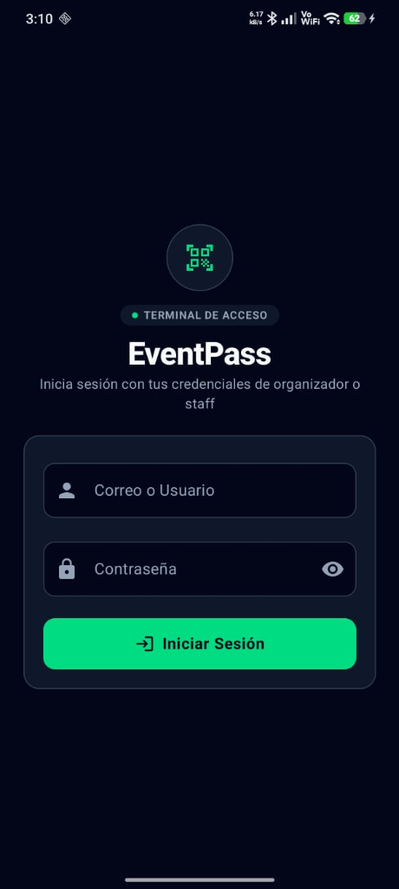
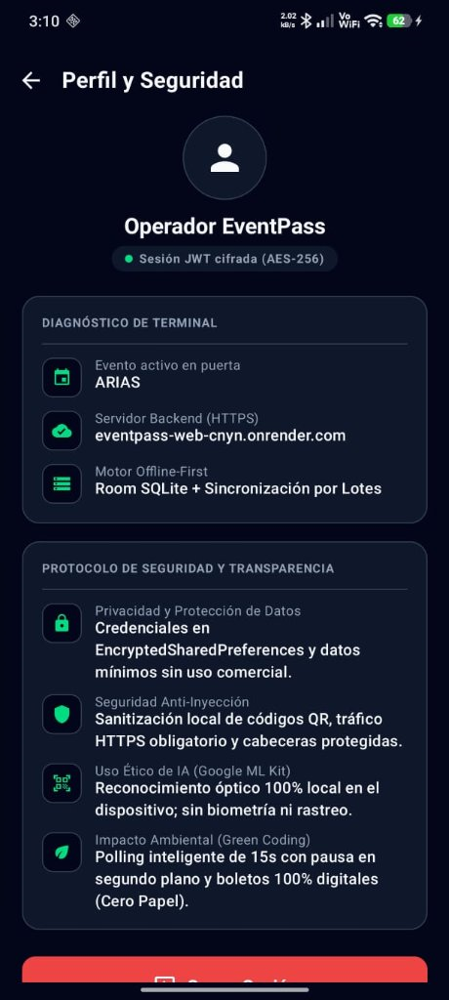

# EventPass App (MVP) — Terminal Móvil de Control de Asistencia con QR

Aplicación móvil desarrollada para Android con **Kotlin** y **Jetpack Compose (Material Design 3)** que actúa como **terminal de acceso híbrida (Online + Offline-First)** conectada a la plataforma web centralizada de **EventPass** desplegada en Render ([Consola de Integración Web](https://eventpass-web-cnyn.onrender.com/pages/interaccion.html)).

El proyecto permite autenticar al personal/administrador mediante **JWT cifrado (AES-256)**, monitorear el aforo del evento en tiempo real con **Auto-Refresh inteligente vinculado al ciclo de vida (`Lifecycle.State.RESUMED`)** y validar boletos mediante el escaneo de códigos QR tanto en línea (contra **MongoDB Atlas** en Render) como sin conexión (mediante **SQLite / Room** con sincronización por lotes).

---

## Diseños de Interfaz

El diseño UI/UX se conceptualizó previamente en Figma y se implementó de manera declarativa con Jetpack Compose siguiendo la paleta oficial de EventPass (`MidnightPanel #020618`, `DeepSlate #0F172A`, `SteelOutline #334155`, `NuxtSignal #00DC82`):

| 1. Splash Screen | 2. Login JWT | 3. Dashboard | 4. Escáner QR | 5. Perfil y Seguridad |
| :---: | :---: | :---: | :---: | :---: |
|  |  |  |  |  |

---

## 📱 Módulos y Funcionalidades Implementadas

1. **Splash Screen (`SplashScreen.kt`):** Pantalla de bienvenida con identidad visual de EventPass y transición automática al flujo de autenticación limpiando el backstack.
2. **Autenticación JWT y Cifrado (`LoginScreen.kt`, `LoginViewModel.kt` & `SessionManager.kt`):**
   * Conexión a `POST /api/auth/login` en Render mediante **Retrofit** + **OkHttp AuthInterceptor**.
   * Almacenamiento seguro del token JWT en **`EncryptedSharedPreferences`** (`AES256_SIV` y `AES256_GCM`).
   * Precarga automática del evento activo del organizador al iniciar sesión.
3. **Dashboard en Tiempo Real con Auto-Refresh Inteligente (`DashboardScreen.kt` & `DashboardViewModel.kt`):**
   * **Selector desplegable de eventos (`ExposedDropdownMenuBox`)** sincronizado con `GET /api/eventos`.
   * **Tarjetas de métricas de alto contraste:** Aforo Total con barra de progreso de ocupación y Accesos Confirmados.
   * **Polling Lifecycle-Aware (15s):** Actualización silenciosa automática que se ejecuta únicamente cuando la pantalla está en estado `RESUMED` y se pausa automáticamente al abrir el escáner o pasar a segundo plano para ahorrar batería y datos.
4. **Escáner QR Inteligente (`ScannerScreen.kt`, `QrCodeAnalyzer.kt` & `ScannerViewModel.kt`):**
   * Integración de **CameraX** + **Google ML Kit Barcode Scanning** (`FORMAT_QR_CODE`).
   * **Control de memoria y Debounce (2 segundos):** Uso de `AtomicBoolean`, liberación garantizada de fotogramas (`imageProxy.close()`) y desconexión de cámara en `DisposableEffect`.
   * **Sanitización Anti-Inyección:** Validación local del payload QR bloqueando URLs externas o caracteres de inyección NoSQL/SQL antes de consultar el backend.
   * **Retroalimentación multisensorial:** Estados visuales dinámicos (Blanco en espera, Amarillo validando, Verde autorizado, Rojo denegado/duplicado) y vibración háptica (`HapticFeedbackType.LongPress`).
5. **Persistencia Offline-First y Sincronización (`AttendanceRepository.kt` & Room Database):**
   * **`AttendeeEntity`:** Copia local indexada del padrón de asistentes de MongoDB Atlas para validación instantánea sin internet.
   * **`PendingCheckInEntity`:** Cola local de boletos escaneados en modo Offline que se sincroniza automáticamente con `POST /api/checkin/sync` al recuperar la conexión.
6. **Perfil de Operador y Transparencia (`ProfileScreen.kt`):**
   * Diagnóstico en vivo del evento asignado, estado de sesión JWT cifrada, protocolo de seguridad/ética integrado y cierre seguro de sesión.

---

## Estructura Limpia de Paquetes (Arquitectura MVVM + Repository)

```text
com.example.eventpass
├── MainActivity.kt                        # NavHost principal (splash -> login -> dashboard -> scanner / profile)
├── data/
│   ├── local/
│   │   ├── AttendeeDao.kt                 # Consultas SQLite para asistentes y cola de sincronización
│   │   ├── AttendeeEntity.kt              # Entidad Room indexada por eventoId y pin
│   │   ├── EventPassDatabase.kt           # Instancia Singleton de Room Database
│   │   └── PendingCheckInEntity.kt        # Entidad Room para check-ins realizados sin internet
│   ├── remote/
│   │   ├── EventPassApi.kt                # Contratos REST (login, eventos, asistentes, checkin, sync)
│   │   └── RetrofitClient.kt              # Cliente OkHttp/Retrofit con inyección Bearer JWT y cabeceras protegidas
│   └── repository/
│       └── AttendanceRepository.kt        # Repositorio híbrido (Render Online + Room Offline-First + Sanitización QR)
├── domain/
│   └── model/
│       └── Assistant.kt                   # Modelo de dominio para la capa de presentación
├── ui/
│   ├── splash/SplashScreen.kt             # Pantalla de inicio
│   ├── login/                             # LoginScreen + LoginViewModel
│   ├── dashboard/                         # DashboardScreen + DashboardViewModel + DashboardUiState
│   ├── scanner/                           # ScannerScreen + ScannerViewModel + QrCodeAnalyzer
│   ├── profile/ProfileScreen.kt           # Módulo de perfil, transparencia y cierre de sesión
│   └── theme/                             # Paleta oficial (Color.kt, Theme.kt, Type.kt)
└── util/
    └── SessionManager.kt                  # Gestión de sesión cifrada con EncryptedSharedPreferences (AES-256)
```

---

## Matriz de Cumplimiento Ético, Seguridad y Calidad (MVP)

| Criterio | Estado | Implementación en el Código de EventPass |
| :--- | :---: | :--- |
| **1. Privacidad y Datos** | ✅ CUMPLIDO | JWT cifrado en `EncryptedSharedPreferences` (`AES-256`). Minimización de datos en `AttendeeEntity` (solo Nombre, PIN y Estado) sin rastreo ni uso comercial. |
| **2. Seguridad Informática** | ✅ CUMPLIDO | Tráfico exclusivo HTTPS (`usesCleartextTraffic="false"`), ofuscación de cabecera `Authorization` en logs, sanitización `isSafeQrPayload()` contra inyecciones y prevención de duplicados en Room. |
| **3. Uso Ético de la IA** | ✅ CUMPLIDO | Google ML Kit restringido exclusivamente a `Barcode.FORMAT_QR_CODE` con procesamiento 100% local en memoria y cierre inmediato de frames (`imageProxy.close()`), sin biometría. |
| **4. Propiedad Intelectual** | ✅ CUMPLIDO | Uso documentado de librerías oficiales Open Source bajo licencia Apache 2.0 (Jetpack Compose, Room, Retrofit, OkHttp, CameraX, ML Kit). |
| **5. Inclusión y Accesibilidad** | ✅ CUMPLIDO | Interfaz Material Design 3 de alto contraste, métricas de gran legibilidad (`30.sp`), etiquetas `contentDescription` y respuesta háptica (`LongPress`) para retroalimentación no visual. |
| **6. Responsabilidad en Dev** | ✅ CUMPLIDO | Arquitectura limpia MVVM + Unidirectional Data Flow (`StateFlow`) + Repositorio Offline-First tolerante a caídas de red. |
| **7. Impacto Ambiental** | ✅ CUMPLIDO | **Green Coding:** Polling de 15s gobernado por `repeatOnLifecycle(Lifecycle.State.RESUMED)` que se pausa en segundo plano. **Paperless (Cero Papel):** Sustitución total de boletos impresos por pases digitales QR. |

---

## Tecnologías y Herramientas

* **Lenguaje:** Kotlin (`2.2.10`) + KSP (`2.2.10-2.0.2`)
* **UI Framework:** Jetpack Compose (Material Design 3)
* **Arquitectura:** MVVM, Unidirectional Data Flow (`StateFlow`), Jetpack Navigation Compose
* **Motor de Escaneo:** CameraX (`1.3.4`) & Google ML Kit Barcode Scanning (`17.3.0`)
* **Conexión Web API:** Retrofit (`2.11.0`), Gson Converter & OkHttp (`4.12.0`)
* **Base de Datos Local (Offline-First):** Room SQLite (`2.7.2`)
* **Seguridad Local:** AndroidX Security Crypto (`EncryptedSharedPreferences`)
* **Backend & Plataforma Principal:** Node.js / Express + MongoDB Atlas desplegado en Render

---

## 🌐 Enlaces del Proyecto
* **Consola Web e Integración en Vivo (Render):** [https://eventpass-web-cnyn.onrender.com/pages/interaccion.html](https://eventpass-web-cnyn.onrender.com/pages/interaccion.html)
* **Video de Funcionalidad de la App:** [Ver en Google Drive](https://drive.google.com/drive/folders/1lM1_-6mu0MgY1J8j-XGGuRATGK7SJaUj)
* **Repositorio Oficial:** [https://github.com/Arias313/EventPass-app-](https://github.com/Arias313/EventPass-app-)
